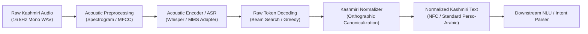

<div align="center">

# 🎙️ Kashmiri Voice Assistant (KoshurVoice)
### Automatic Speech Recognition (ASR) Workstream

[](https://www.python.org/downloads/)
[](https://github.com/astral-sh/ruff)
[](https://docs.pytest.org/)
[](LICENSE)
[](CONTRIBUTING.md)

<p align="center">
  <b>A research-grade acoustic modeling and orthographic normalization pipeline engineered for low-resource Kashmiri speech processing.</b>
</p>

[System Architecture](#-system-architecture) •
[Directory Layout](#-project-structure) •
[Quickstart](#-quickstart--installation) •
[Verification](#-testing--quality-assurance) •
[Data Governance](#-data-governance--privacy) •
[Collaboration](#-contribution--workflow)

---

</div>

## 📖 Executive Summary

The **Kashmiri Voice Assistant (KoshurVoice) — ASR Workstream** is dedicated to building an end-to-end, reproducible speech-to-text pipeline for the Kashmiri language (Perso-Arabic script). Kashmiri poses distinct computational challenges: significant orthographic variance across texts, high degrees of phonetic nuance (e.g., vowel centralization, palatalization), and scarce supervised training pairs.

This repository hosts the foundational engineering infrastructure for:
1. **Orthographic Canonicalization**: Deterministic normalization across divergent Perso-Arabic unicode character representations (e.g., Arabic vs. Farsi Yeh, Keheh vs. Kaf).
2. **Acoustic Modeling & Adaptation**: Fine-tuning pre-trained multi-lingual foundations (Whisper, Meta MMS, Wav2Vec2-XLSR) on annotated Kashmiri corpora.
3. **Evaluation Harness**: Automated evaluation pipelines tracking Word Error Rate (WER), Character Error Rate (CER), and latency across domain-specific test benches.

---

## 🏛 System Architecture

The following diagram illustrates the ASR inference and normalization pipeline within the broader voice assistant framework:



---

## 📂 Project Structure

The repository follows standard AI/ML production engineering conventions:

```text
kashmiri-voice-assistant/
├── .github/
│   └── pull_request_template.md    # Standardized PR checklist (Jira, tests, data checks)
├── configs/                        # Pipeline & experiment hyperparameter declarations
│   └── config.yaml.example         # Baseline configuration template
├── data/                           # Local datasets directory (NEVER committed to Git)
│   ├── raw/                        # Immutable raw audio collections
│   ├── interim/                    # Preprocessed spectrograms / tokens
│   ├── processed/                  # Manifests and train/val/test splits
│   └── README.md                   # Data privacy guidelines & cloud fetch instructions
├── docs/                           # Architecture specs, orthography standards, notes
├── notebooks/                      # Exploratory data analysis (EDA) & error diagnostic notebooks
├── reports/                        # Publication figures, confusion matrices, and benchmark tables
├── scripts/                        # Standalone CLI tools (data loaders, benchmark harnesses)
├── src/                            # Core Python source package
│   └── voice_assistant/
│       ├── __init__.py
│       └── asr/                    # Speech recognition module
│           ├── __init__.py
│           └── normalizer.py       # Deterministic text normalizer & character mapper
├── tests/                          # Unit and integration test suite
│   ├── __init__.py
│   ├── test_normalizer.py          # Orthographic normalization test cases
│   └── test_placeholder.py         # Test harness sanity assertions
├── .env.example                    # Template for local environment variables & tokens
├── .gitignore                      # Hardened filter for secrets, weights, audio & datasets
├── CONTRIBUTING.md                 # Branching policies, code review protocol, Jira guidelines
├── pyproject.toml                  # Modern PEP 517/621 package build configuration
├── requirements.txt                # Production runtime dependencies
└── requirements-dev.txt            # Development, linting, and testing dependencies
```

---

## ⚡ Quickstart & Installation

### 1. Prerequisites
- **Operating System**: Linux (Ubuntu 22.04+ recommended), macOS, or WSL2 on Windows.
- **Python**: Version `3.10` or higher (`python3 --version`).
- **Git**: Configured with user identity.

### 2. Environment Setup

Clone the repository and set up an isolated virtual environment:

```bash
# Clone the shared repository
git clone https://github.com/<ORGANIZATION-OR-USER>/kashmiri-voice-assistant.git
cd kashmiri-voice-assistant

# Create virtual environment
python3 -m venv .venv

# Activate environment
source .venv/bin/activate       # Linux / macOS
# .venv\Scripts\activate        # Windows (cmd/PowerShell)

# Upgrade pip to latest release
pip install --upgrade pip
```

### 3. Install Dependencies

You can choose between standard `requirements` or modern editable `pyproject.toml` installation:

```bash
# Option A: Standard requirements (Fastest for experimentation)
pip install -r requirements-dev.txt

# Option B: Editable package installation (Recommended for development)
pip install -e ".[dev]"
```

### 4. Configure Environment Variables

```bash
# Create local configuration from template
cp .env.example .env

# Edit .env with your local credentials (HuggingFace token, W&B key)
# Note: .env is automatically ignored by Git and must NEVER be committed.
```

---

## 📄 License

This project is licensed under the terms of the [MIT License](LICENSE).
