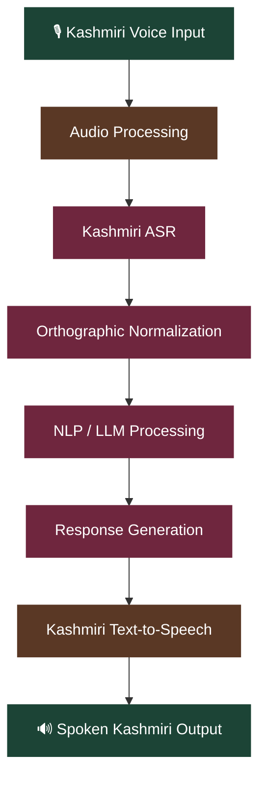

#  Kashmiri Voice Assistant

<p align="center">
  
  
  
  
</p>

<p align="center">
  <strong>Building a voice-based conversational experience for Kashmiri through speech recognition, text normalization, language processing, and speech synthesis.</strong>
</p>

---

## 📖 About the Project

The **Kashmiri Voice Assistant** is a speech-processing project focused on enabling natural voice-based interaction in Kashmiri.

The project combines automatic speech recognition (ASR), orthographic normalization, natural language processing (NLP), and text-to-speech (TTS) into a modular pipeline.

A central research focus is developing and evaluating reproducible Kashmiri speech-to-text models, with particular attention to the complexities of Kashmiri Perso-Arabic script and Unicode representation.

## ✨ Key Features

-  **Kashmiri Speech Recognition** — Fine-tuning multilingual speech models for Kashmiri audio transcription.
-  **Orthographic Normalization** — Standardizing Unicode character variants, diacritics, and written representations.
-  **Conversational Processing** — Connecting recognized speech to NLP and language model components.
-  **Speech Synthesis** — Generating spoken Kashmiri responses through TTS.
-  **Model Evaluation** — Measuring transcription performance using WER and CER.
-  **Reproducible Experiments** — Organizing datasets, configurations, and evaluation results for consistent benchmarking.

##  System Architecture



##  Technology Stack

<p align="center">
  
</p>

| Component | Purpose |
|---|---|
| Python | Core development and experimentation |
| PyTorch | Deep learning and acoustic model training |
| Multilingual ASR models | Kashmiri speech recognition |
| NLP / LLM components | Conversational understanding and response generation |
| TTS models | Spoken response generation |
| WER / CER | Speech recognition evaluation |

*The stack reflects the intended project architecture; specific model implementations and dependencies may evolve.*

## 📂 Repository Structure

```text
kashmiri-voice-assistant/
├── README.md
├── .gitignore
├── .env.example
├── pyproject.toml
├── configs/                 # Model and experiment configurations
├── data/                    # Local or approved datasets
├── docs/                    # Project documentation
├── notebooks/               # Research and experimentation
├── reports/                 # Evaluation results and reports
├── scripts/                 # Training and evaluation scripts
├── src/
│   └── voice_assistant/
│       └── asr/             # ASR and text normalization
└── tests/                   # Automated tests
```

## 🚀 Getting Started

### Prerequisites

- Python 3.10 or later
- Git
- A compatible environment for the selected speech recognition models

### Installation

**1. Clone the repository**

```bash
git clone https://github.com/AseefBandey/kashmiri-voice-assistant.git
cd kashmiri-voice-assistant
```

**2. Create a virtual environment**

```bash
python3 -m venv .venv
source .venv/bin/activate
```

Windows:

```powershell
.venv\Scripts\activate
```

**3. Install dependencies**

```bash
python -m pip install --upgrade pip
pip install -e ".[dev]"
```

**4. Configure environment variables**

```bash
cp .env.example .env
```

Update `.env` with the required local configuration. Keep credentials and secrets out of version control.

## 🧪 Testing

Run the test suite to verify the implemented components.

```bash
PYTHONPATH=src python -m unittest discover -s tests
```

Alternatively, if `pytest` is configured:

```bash
pytest
```

## 📈 Evaluation Metrics

| Metric | Description |
|---|---|
| Word Error Rate (WER) | Measures word-level transcription errors |
| Character Error Rate (CER) | Measures character-level transcription errors |

Both metrics account for substitutions, deletions, and insertions. Evaluation should use consistent datasets, preprocessing, and normalization rules to ensure fair comparisons.

## 🔬 Research & Reproducibility

The project emphasizes transparent and reproducible experimentation:

- Use appropriately licensed and approved speech datasets.
- Keep raw audio and large datasets out of version control.
- Document preprocessing and normalization procedures.
- Record model configurations, training settings, and evaluation results.
- Maintain consistent evaluation protocols across experiments.

## 🛣️ Roadmap

- [ ] Develop and validate Kashmiri orthographic normalization.
- [ ] Prepare reproducible speech dataset preprocessing pipelines.
- [ ] Fine-tune multilingual ASR models for Kashmiri.
- [ ] Benchmark models using WER and CER.
- [ ] Integrate conversational NLP components.
- [ ] Integrate Kashmiri text-to-speech.
- [ ] Develop an end-to-end voice assistant interface.


## 📄 License

A license has not yet been specified. Please check the repository for licensing information before using or redistributing the project.

---

<p align="center">
  <strong>Advancing speech technology for the Kashmiri language.</strong>
</p>


